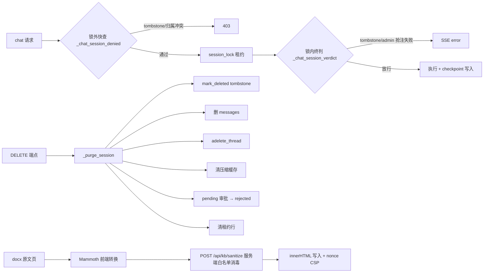

# v0.17.37 代码评审报告（双子代理交叉验证）

日期：2026-11-01

评审对象：提交基线 `2ec462f`（v0.17.36）之上的工作区变更——P0 两项安全加固
（会话删除生命周期封禁 + 知识库原文 XSS 防护/Cookie 迁移）。

对应 spec：`docs/specs/security-hardening-v0.17.37.md`

参考：`docs/reviews/2026-11-01-v0.17.36-architecture-review.md`（本轮整改依据）、
`docs/reviews/2026-11-01-v0.17.37-architecture-rereview.md`（实现后架构复验）。

## 1. 评审方法与范围

按本仓库 TRAE-code-review 流程执行：

1. 范围判定：`git status` + `git diff --stat`（16 文件：main.py / sessions.py /
   session_lock.py / approval.py / config.py / html_sanitize.py（新）/ 前端两页面 /
   测试三文件（新两文件）/ 文档），spec 一并读入作对照基准；
2. 上下文收集：逐文件 diff + 新文件全文，关联模块（auth / agent / packs /
   既有测试）按需读入；修复前基线定向测试确认全绿（648 passed / 18 skipped）；
3. 意图推断（见第 2 节）；
4. 主代理自查产出 14 项候选（正确性 / 安全边界与拒绝路径 / 可维护性四维）；
5. **双子代理并行独立交叉验证**：两个 general-purpose 子代理互不可见对方
   结论，逐条给【确认】/【证伪】+ 理由 + 证据（文件:行号），允许跑 Python
   实验（httpx Content-Length 透传、畸形 HTML/CDATA/URL 走私注入、
   并发回填争抢等），只验证不改代码；
6. 按票数裁决：**2/2 确认纳入；0/2 证伪排除**（本轮无 1/2 分歧项）；
7. 修复选择经用户裁决：**两项确认问题全部修复**。

## 2. 变更意图

v0.17.36 架构审核报告 §9 整改顺序第 1 步：P0-1「删除会话后复用
session_id 可接续旧模型上下文」——引入 session_meta 所有权表 + tombstone
永久封禁 + `_purge_session` 五覆盖面清理（messages / checkpointer / 压缩
缓存 / 挂起审批 / 租约）；P0-2「知识库 Word 原文视图存储型 XSS + 凭据
localStorage」——服务端统一 `_esc()` 转义 + stdlib 白名单消毒器 +
`POST /api/kb/sanitize` 消毒通道 + nonce CSP，浏览器登录态完整迁移
HttpOnly Cookie（SameSite=Lax + X-Requested-With CSRF 纵深）。



## 3. 确认问题（2/2 票，均修复）

### #1 sanitize 端点 413 检查在 body 全量读入之后（低危，DoS 面）

- 位置：`server/main.py` kb_sanitize（修复前 pydantic 模型签名）
- 问题：spec 4.3「限长 2MB」原设计经 `len(req.html)` 判定，FastAPI 在
  handler 执行前已完成 body 全量读入与解析——恶意超大请求仍先占满内存
  与 JSON 解析开销，限长保护形同事后校验。上传端点
  `_check_body_limit`（main.py:857）已有 Content-Length 头部预检先例，
  sanitize 端点未对齐。
- 验证：双子代理均以 httpx 实验证实显式 Content-Length 头会被透传尊重
  （`httpx.Request(..., content=b'{}', headers={'Content-Length':'99999999'})`
  服务端 `request.headers.get("content-length")` 读到 99999999），
  预检可在读 body 前拦截。
- **修复**：kb_sanitize 改 `Request` 签名，Content-Length 前置预检——
  超限头直接 413、非法头 400（main.py:1199-1204），再手动
  `await request.json()` + `KbSanitizeRequest(**body)`（异常 422），
  长读后 `len()` 兜底 413 保留（无 Content-Length 的 chunked 请求，
  main.py:1210-1211）。保留 pydantic 模型签名则 body 在 handler 前已被
  读入、预检无意义，故签名改为 `Request`。
- 回归：`tests/test_kb_source_xss.py::test_ac10_sanitize_content_length_precheck`
  ——伪造超限 Content-Length 头 + 小 body → 413；`"abc"` → 400；
  正常请求 → 200。

### #2 快查存量分支 owners 全体口径 vs 终判 resolve_owner 口径（低危，过严方向不越权）

- 位置：`server/main.py:650-671`（修复前 `_chat_session_denied` 存量分支）
- 问题：锁内终判对存量会话（meta 无）按 `resolve_owner`（最早 user 消息
  作者）回填归属，锁外快查却沿用 v0.17.32 的 owners 全体推断——存量
  双作者会话（如 bob 最早发言、alice 后来发言）的合法属主 bob 会被
  快查误拒 403，而锁内终判会放行：同一身份在锁内外得到不同结论。
  过严方向（无越权）但伤可用性，且快查/终判口径分裂违反「快路径是
  终判子集」的双查设计原则（v0.17.33 先例）。
- 验证：子代理 B 实测窗口场景——存量 owners={bob,alice} 且最早消息为
  bob 时，bob 快查 403 拒、终判放行；子代理 A 逐行比对两函数分支
  确认口径分裂仅在存量 meta 无的分支。
- **修复**：`_chat_session_denied` 存量分支改用与终判一致的
  `sessions.resolve_owner`（最早作者归属，顺带回填 meta）——
  main.py:668-671，docstring 注明修复依据。
- 回归：`tests/test_session_acl.py` 新增两例——
  `test_ac1_chat_legacy_multi_author_owner_allowed`（最早作者续聊 200，
  旧口径会 403 误拒）、`test_ac1_chat_legacy_multi_author_second_user_403`
  （第二作者 403，行为与旧口径拒绝侧一致）；既有 10 例（含 2 race 例）
  与 resolve_owner 口径逐一推演兼容。

## 4. 证伪排除项（0/2，摘主要项）

以下候选经双子代理独立验证均证伪（附证据），不修复：

1. **登录端点 CSRF 可利用**——实测跨站表单/form 提交无法以
   `application/json` 到达 login（FastAPI 422），login 主体为 JSON API，
   cookie 豁免不构成可利用面；
2. **MemorySaver/AsyncPostgresSaver 缺 adelete_thread 导致删除覆盖面缺口**
   ——`hasattr` 双后端实验均原生支持，双后端同口径物理删除成立；
3. **消毒器可被畸形 HTML/CDATA/URL 走私绕过**——注入实验矩阵
   （未闭合标签、`<![CDATA[<script>]]>`、控制字符 scheme 走私、
   `data:text/html`、SVG data URI、注释/声明 smuggle）均被
   `_safe_url` 控制字符剥离（`\x00-\x1f\x7f`）与 drop/strip 双模式
   栈正确处置，AC7 用例已覆盖；
4. **resolve_owner 并发回填争抢**——8 线程并发同 owner 实验回填幂等
   （INSERT OR IGNORE + 回读校验），无归属漂移；
5. **PDF 原文页同款 XSS**——PDF 渲染走浏览器内建查看器（非 innerHTML
   拼接），不在本漏洞类别；docx/docx-x/文本片段已全转义；
6. **既有 Bearer 测试回归**——Bearer 优先级保留且 cookie 回退仅在
   Bearer 失效时触发，全量 Bearer 用例通过；
7. **anonymous 宽恕可被冒用接续**——与既有 `_can_access_session`
   owners 宽恕口径一致（spec 3.1 明示对齐），非本轮新开口子；
8. 其余 5 项（SSE 流中 charset/编码边界、锁粒度、tombstone 表膨胀、
   cookie Max-Age 单位、前端 XRW 头遗漏路径）经代码逐行核对与实验
   均不成立或已有既有防线，不赘述。

## 5. 有意保留与遗留项（不属本轮两项修复）

- **P0-1 删除与在途 chat 并发的终局语义**（rereview P0）：spec 3.3
  并发决策已明示——删除不取会话租约（治理动作即时性），极端并发下
  可能残留少量 checkpoint/审批痕迹，tombstone 已封禁新请求入口。
  rereview 建议的代际/fencing token 终局协议为后续轮次候选
  （rereview §5 第 1 条），本轮不夹带；
- **存量混合归属/anonymous 认领**（rereview P1）：spec 3.1 明示回填
  语义与既有 `owners <= {本人, anonymous}` 宽恕口径对齐——这是有意的
  存量兼容决策，收紧策略（legacy_quarantined）留待后续轮次评估；
- **SSO 身份一致性 / 共享技能审批**（rereview P1 两项）：上轮报告遗留，
  本轮范围外，v0.17.38 起按报告 §9 顺序推进；
- **Cookie 生产化**（rereview P2）：AUTH_COOKIE_SECURE 生产 HTTPS 部署
  开启（spec 4.5 设计）、登录响应体保留 token 为程序化 curl 兼容
  （spec 明示）、AC11 浏览器 E2E 为部署人工验收项（本轮明确排除
  自动化）。

## 6. 修复后验证结果

```text
定向回归：tests/test_kb_source_xss.py + tests/test_session_acl.py
          20 passed（含本轮新增 3 例：#1 预检 1 例 + #2 口径 2 例）
全量回归：651 passed, 18 skipped, 0 failed（95.30s）
          ——基线 622 + spec 用例 26 + 评审修复 3 = 651 吻合，0 failed
```

修复后基线较修复前（648）无回归，评审修复新增 3 例全部通过。

## 7. 结论

14 项候选经双子代理独立交叉验证：**2 项确认（#1 DoS 面、#2 过严口径，
均低危）、12 项证伪排除**。确认项经用户裁决全部修复，spec 3.2/4.3 已
回写修订注，回归全绿。本轮变更达到提交标准；rereview 提出的在途并发
终局语义等遗留项记录于第 5 节，按报告 §9 顺序后续轮次推进。
