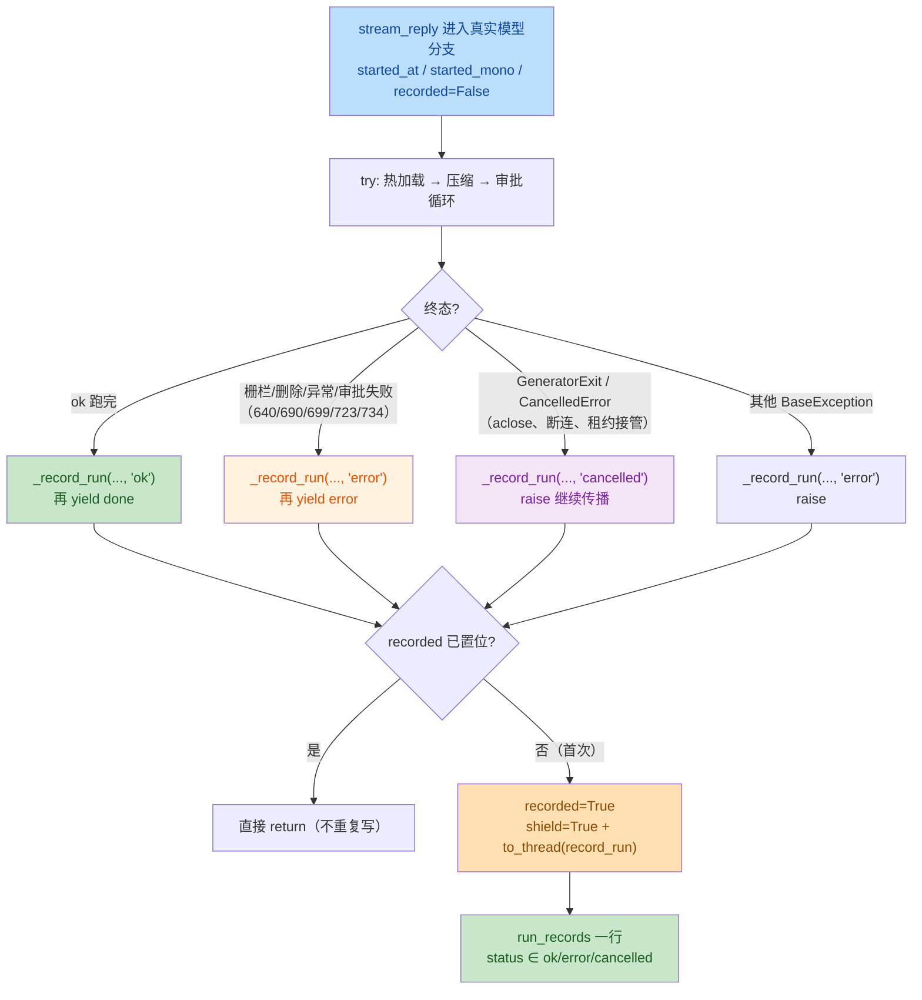

# 6.8 run 墙钟时长 — 实现代码评审（v0.17.52）

**评审日期**：2026-11-10
**评审性质**：全量评审本轮 6.8「run 墙钟时长（口径 B）」未提交改动（非窄复审）
**基线**：HEAD `886cd01`，改动全部未提交、未 push
**产出方式**：**只读评审**。唯一写入 = 本报告；未修改任何实现、测试、依赖或 spec

## 0. 范围与证据

以 `git status --short` / `git diff --stat HEAD` 实测，本轮范围如下（不含 `docs/reviews/2026-11-09-6.8-spec-review*.md` 两份 spec 评审，它们在 6.8 实现之前产出，不在本次代码评审范围）：

| 文件 | 变动 | 内容 |
|---|---|---|
| `server/usage.py` | +77 | `run_records` 表、`record_run()`、`run_usage()` 二次查询、`summary().by_run` 的 LEFT JOIN |
| `server/agent.py` | 274 行变动 | `stream_reply` 计时起点、`_record_run`、五处 error 终态、ok 终态、取消/异常兜底 |
| `server/routes/chat.py` | 42 行变动 | `contextlib.aclosing` 关闭内层生成器 |
| `tests/perf_baseline.py` | +37 | 脚本内 seed 40 个双表 run + 10 个仅 usage 行（共 50） |
| `requirements.txt` | +3 | 新增直接依赖 anyio |
| `docs/specs/6.8-run-wallclock-duration.md` | 未跟踪（新） | 本轮 spec |
| `tests/test_usage_run_wallclock.py` | 未跟踪（新） | 16 条用例（AC1–AC12） |

### 验证执行

```
pytest tests/test_usage_run_wallclock.py tests/test_usage.py tests/test_usage_run_health.py -q
→ 35 passed in 14.37s（仅 LangGraph 弃用告警）
```

### 微基准（本机，SQLite WAL，同一 `USAGE_DB` 形态）

| 调用 | p50 | p95 |
|---|---|---|
| 单次 `_query` | 4.40 ms | 7.63 ms |
| `run_usage()`（本轮 = 2 次 `_query`） | 8.02 ms | 13.47 ms |
| `summary()`（含 `by_run`） | 16.81 ms | 22.11 ms |
| `summary()` 禁 `_ensure_schema` 对照 | 15.33 ms | 23.35 ms |

DDL 对照差仅约 1.5ms（p95 甚至反向），**故不把「每次 `_query` 重跑 DDL」单列为本轮问题**。

## 1. 推断意图

为「一次 `/api/chat` run 的端到端墙钟」建立独立事实表 `run_records`，与 token 计量表 `usage_records` 解耦：

- 起点放在 **Mock 分支之后**（`server/agent.py:577-589` 之后），因此覆盖工具热加载、上下文压缩、审批等待，但不覆盖 Mock 演示、路由排队与 `run_triggered` 触发的 run；
- 终态落账在 **yield 终态事件之前**完成，保证 `done.usage.run` 与数据行同源；
- `wall_ms` 取 `usage._mono()` 差值（单调时钟），`started_at/finished_at` 取 `time.time()`（wall clock），二者分栏存放以免时钟回拨污染时长；
- 聚合视图 `summary().by_run` 用 LEFT JOIN 补 `wall_ms`，单 run 视图 `run_usage()` 则用**独立的第二次查询**，以保证零模型调用的 run 也能拿到墙钟。

## 2. 变更概览

**终态落账分支（所有路径都过 `recorded` 闸门，每 run 至多一行）：**



**客户端断连时的取消链路：**

```mermaid
sequenceDiagram
    participant C as Client
    participant R as "routes/chat.py"
    participant A as "agent.stream_reply"
    participant U as "usage.record_run"
    participant DB as "run_records"
    C--xR: "断开连接"
    R->>R: "aclosing 触发 inner.aclose()"
    R->>A: "GeneratorExit（生成器挂起点）"
    A->>A: "except (GeneratorExit, CancelledError)"
    A->>A: "shield=True CancelScope + to_thread"
    A->>U: "record_run(..., 'cancelled')"
    U->>DB: "INSERT 一行（wall_ms>0）"
    DB-->>U: "ok"
    A->>A: "raise（取消继续向上传播）"
    R->>R: "finally: append_fenced 落部分回复"
    style R fill:#bbdefb,color:#0d47a1
    style A fill:#fff3e0,color:#e65100
    style DB fill:#c8e6c9,color:#1a5e20
```

## 3. 结论

**P0 = 0，P1 = 0，P2 = 3。**

三条 P2 均**不阻断 6.8 提交**；其中 P2-3（Postgres 可迁移性）在 6.4 Postgres 化落地前必须处理。用户点名的 5 个重点中，取消落盘、去重唯一性、`by_run` SQL 与锁、建表幂等、语义边界**核对后均不成立**（见 §5），另有两处属测试覆盖边界而非缺陷。

## 4. P2 明细

| ID | 级别 | 位置 | 触发路径 | 影响 | 建议 |
|---|---|---|---|---|---|
| P2-1 | P2（性能 / 规范） | `server/agent.py:743-747`；`server/usage.py:336-362`、`313-322`、`130-137`、`140-186` | 每个正常完成的 run 在 `done` 事件前同步查两次库 | 事件循环被阻塞约 8ms（p50）/ 13ms（p95），违反 `docs/CODING-STANDARDS.md:66` 的 must 条款；并发流式会话下相互叠加 | done 路径的 `run_usage` 与 `session_usage` 一起 `asyncio.to_thread` |
| P2-2 | P2（并发 / 延迟） | `server/usage.py:236-246`（配合 `:80`、`:209`、`:267`、`:280`、`:297`、`:313-322`；触发点 `server/agent.py:612-616`） | `record_run` 持 `_lock` 做连接/建表/INSERT/commit；同进程事件循环线程同时要拿同一把非重入锁 | 跨进程共享 `USAGE_DB` 时若遇写锁竞争，事件循环最多被阻塞约 3s（`busy_timeout=3000`） | 缩小锁范围（连接/建表移出锁内），或在 spec 风险登记中显式登记 |
| P2-3 | P2（可迁移性，对 6.4 阻断） | `server/usage.py:417-430`；DDL `server/usage.py:170-182`（`started_at/finished_at REAL` `:177-178`）；spec §8 | 执行 6.4 Postgres 化时，`by_run` 直接迁移 | PG 下 `GROUP BY u.run_id` + 裸列 `u.session_id/u.user_id/u.date` 非法；`REAL`→`real`(float4) 存 epoch 秒精度不足（ulp≈128s） | 6.4 前重写 SQL 并登记 DDL 类型（`timestamptz`/`double precision`） |

### 4.1 P2-1：done 路径同步查库阻塞事件循环（既有欠账的增量）

`server/agent.py:743-747`：

```python
await _record_run(usage._mono(), "ok")
yield {"type": "done", "usage": {
    "run": usage.run_usage(run_id) if run_id else {},
    "session": usage.session_usage(session_id),
}}
```

`run_usage`（`server/usage.py:336-362`）本轮由 1 次 `_query` 变为 **2 次**（`usage_records` 聚合 + `run_records` 单行），每次 `_query` 内部都要 `_connect()`（`:130-137`）并 `_ensure_schema()`（`:140-186`）。实测单次 `_query` p50 4.40ms、`run_usage` p50 8.02ms，这段直接在**事件循环线程**里执行，期间其他会话的 SSE 帧无法推进。

需要说明这是**既有欠账的增量**，不是本轮引入的新模式：`session_usage(session_id)` 在改动前也是同步调用，`server/usage.py` 的回调（`:267`/`:280`/`:297`）同样在事件循环线程取锁。因此定级 P2 而非 P1。修法很小——把两条查询合并成一次 `await asyncio.to_thread(...)` 即可，同时消除 `done` 前的一次事件循环停顿。

依据：`docs/CODING-STANDARDS.md:66`「async 上下文中调用同步阻塞操作（SQLite、文件 IO、锁）必须 `asyncio.to_thread(...)` 包装」。

### 4.2 P2-2：`record_run` 的锁范围与 `busy_timeout` 上限

`server/usage.py:236-246` 在 `_lock` 内完成 `_connect()` → `_ensure_schema()` → `INSERT` → `commit()` → `close()`。`_lock` 是 `threading.Lock()`（`:80`），**非重入**，且事件循环线程在以下位置同步竞争它：

- `record()`（`:209`，每次 LLM 调用结束时经 `on_llm_end`/`on_llm_error` 触发）；
- `on_llm_start` 的 `starts` 字典维护（`:267`）；
- `_query()`（`:313-322`，`run_usage`/`session_usage`/`summary` 全部经过）。

本轮起 `record_run` 由 `server/agent.py:612-616` 的 `asyncio.to_thread` 在**工作线程**执行，所以行本身不会阻塞事件循环；但**锁**会把事件循环线程挡住。正常情况下锁内只有一次本地 INSERT（亚毫秒），风险来自跨进程：`docs/CONCURRENCY.md:72` 与 `docs/PRODUCTION.md:101/128` 确认支持同机多进程共享 `USAGE_DB`，此时 `busy_timeout=3000`（`server/usage.py:130-137`）意味着最坏情况事件循环被一个外部进程的写锁拖住约 3 秒。

P2 定级理由：需要「多进程 + 同时写」才触发，且 3s 是上限不是常态。建议二选一：把连接创建与 `_ensure_schema` 移出 `_lock`（只让 INSERT+commit 持锁），或把该上限写入 spec §7 风险登记。

### 4.3 P2-3：`by_run` 与 DDL 在 Postgres 下的可迁移性

`server/usage.py:417-430`：

```sql
SELECT u.run_id AS run_id, u.session_id AS session_id,
       u.user_id AS user_id, u.date AS date, COUNT(*) AS calls,
       ...
       MAX(r.wall_ms) AS wall_ms
  FROM usage_records AS u
  LEFT JOIN run_records AS r ON r.run_id = u.run_id
 {cond_u} GROUP BY u.run_id ORDER BY MAX(u.ts) DESC LIMIT 50
```

两点在 SQLite 下无碍、在 PG 下不成立：

1. `GROUP BY u.run_id` 时 `u.session_id`、`u.user_id`、`u.date` 是裸列。SQLite 允许函数依赖外的裸列，PG 要求出现在 `GROUP BY` 或聚合中。注意这**不是**「因为 `run_id` 是 `run_records` 主键所以安全」——`usage_records` 自身的主键是 `id`，`run_id` 在 `usage_records` 上没有唯一约束，PG 不会接受这种推断。
2. `started_at REAL` / `finished_at REAL`（`server/usage.py:177-178`）字面映射到 PG 的 `real`（float4，约 7 位有效数字）。epoch 秒量级（约 1.7e9）在 float4 下的最小可分辨间隔约 128 秒，时间戳会退化成分钟级噪声。应映射为 `timestamptz` 或 `double precision`。

另外，仓库内**没有** 6.4 的 DDL 清单文件，spec §8 只以自然语言要求「`run_records` 必须显式收录进 Postgres DDL 清单」，没有登记「`by_run` 需要改写 SQL」这一条。建议在 6.4 的前置清单里补上这两项，否则 6.8 的表结构会在迁移时静默降级。

**为什么是 P2 而不是 P1**：当前运行在 SQLite 上（`server/usage.py:124-137` 即 SQLite 专属实现），本轮的运行时行为、测试结果、`/api/usage` 输出全部正确，缺陷只在 6.4 切换 Postgres 的那一刻暴露，且暴露方式是报错或精度退化而非静默算错金额；同时 6.4 尚未开工，有充足的修正窗口。因此定为「6.8 不阻断、6.4 前置必办」的 P2。

## 5. 核对后不成立

### 5.1 取消三路径都能落 `cancelled`

| 路径 | 机制 | 证据 |
|---|---|---|
| 客户端断连 | `StreamingResponse` 取消路由任务 → 生成器在挂起点收 `CancelledError` → `chat.py` 的 `finally` 触发 `aclosing` 的 `aclose()` | `server/routes/chat.py:154-160`、`:177-191`；`server/agent.py:748-751` |
| 租约接管 | `if lease.lost:` 分支 `break` 出 `async for`，`async with aclosing` 退出时 `aclose()` 内层生成器 | `server/routes/chat.py:162-167`、`:154` |
| `GeneratorExit` | `aclose()` 向生成器抛 `GeneratorExit`，与 `CancelledError` 同一 `except` 元组 | `server/agent.py:748-751` |

三者在 `except (GeneratorExit, asyncio.CancelledError)` 汇合，调用 `_record_run(usage._mono(), "cancelled")` 后 `raise`，最终都写入恰好一行 `status='cancelled'` 且 `wall_ms>0`（起点在 Mock 分支之后，走到这里必然已过起点）。AC8a/8b/8c 三条用例覆盖。

### 5.2 shield 范围没有过大、没有吞取消

`with anyio.CancelScope(shield=True)` 只包住**一次** `await asyncio.to_thread(...)`（`server/agent.py:612-616`），作用域内没有其他 `await`、没有 yield、没有用户代码。退出 `with` 块后 shield 立即失效，紧接着 `except` 块里的 `raise` 把原始取消继续向上传播，因此：

- 不会把「本该终止的后续工作」一起屏蔽（shield 内没有任何后续工作）；
- 不会静默吞取消（`raise` 在 shield 之外执行）；
- 若 `record_run` 自身抛异常，`except Exception` 只记类型名并继续 `raise` 原异常（`:617-618`），落账失败不改变取消语义。

唯一残留依赖是 anyio 的 shield 语义本身（裸 `asyncio.Task.cancel()` 不经过 anyio 时不受 shield 保护），该项已在 spec §7 风险登记，按用户要求不重复报告。

### 5.3 `recorded` 保证每 run 只写一行

`recorded = True` 在函数内**第一个 `await` 之前**置位（`server/agent.py:603-605`），且 `stream_reply` 是单个异步生成器、所有终态路径在同一协程内串行抵达，不存在两个协程同时进入 `_record_run` 的窗口：

- ok→done 阶段抛错：`ok` 已写，后续 `BaseException` 分支进入 `_record_run` 时 `recorded` 已为 `True`，直接 `return`；
- error 兜底（五处 `:640/:690/:699/:723/:734`）+ 外层 `except BaseException`（`:752-755`）：同样第二次进入即短路；
- `finally` 语义：本实现**不使用** `finally` 落账，兜底由 `except` 分支覆盖，因此不存在「finally 在 raise 过程中再次写库」的情况。

`record_run` 内部还有 `if not run_id: return`（`server/usage.py:232-233`）作为第二道闸门。关于主键冲突：`chat.py:73` 每个请求生成新 `uuid4().hex[:12]`，同一 `run_id` 跨生成器复用不可达；即便人为复用，`IntegrityError` 也会被 `except Exception` 吞掉，不会写第二行、不会上抛。

### 5.4 `by_run` 的同名列与锁

- **同名列**：`usage_records` 与 `run_records` 都含 `run_id/session_id/user_id/status/created_at`，SQL 中 `run_id/session_id/user_id/date/calls/...` 全部带 `u.` 前缀，`wall_ms` 唯一来自 `r.`（`:426`），不存在歧义列名。
- **`MAX(r.wall_ms)`**：`run_records.run_id` 是主键，一个 `u.run_id` 至多匹配一行 `r`，`MAX` 与裸列等价，同时避免 PG 的裸列限制——但**这不能救** `u.session_id/u.user_id/u.date` 三列（见 P2-3）。
- **行放大**：LEFT JOIN 的右表按主键匹配，不会放大左表行数；左表是 `usage_records`，因此零模型调用的 run 天然不出现在 `by_run` 中——这与 spec §2.10「`by_run` 一行 = 一个『有模型调用记录』的 run」一致，不是缺陷。
- **自锁**：`run_usage` 的两次 `_query`（`server/usage.py:341-355`）各自独立 `with _lock:`，第一次在返回前已释放；`record_run` 内部不调用 `_query()`（docstring `:230` 明确约束），`_lock` 非重入但没有任何嵌套获取路径，不会自锁。

### 5.5 建表、老库升级与幂等

`_ensure_schema`（`server/usage.py:140-186`）全程 `CREATE TABLE IF NOT EXISTS` + 对老库逐列 `ALTER TABLE ADD COLUMN`，本身幂等；`run_records` 的 DDL 在 `:170-182`，索引在 `:183-186`。老库升级路径是**惰性**的：任意一次 `_query()`（`:318`）或 `record_run()`（`:239`）都会先调 `_ensure_schema`，因此老库无需停机迁移即可建出新表——AC5 覆盖该路径，实测通过。

### 5.6 语义边界与 spec 一致

- `int()` 截断：`max(0, int((finished_mono - started_mono) * 1000))`（`server/agent.py:616`），向下取整到毫秒，与 AC10 的 1250ms 断言一致；`max(0, ...)` 防单调时钟异常导致的负值。
- 零模型调用 run：仍然写 `run_records`（起点在模型调用之前），只是 `usage_records` 无行，故 `run_usage` 必须走第二次查询、`by_run` 不出现该 run——与 spec §2.2/§2.10 一致。
- `run_triggered` 的 run 不覆盖：起点位于 Mock 分支之后，而 `run_triggered` 由编排引擎触发、不经过 `stream_reply` 的该段路径，因此不会被本改动计入。与 spec §2.1 一致。
- 「断连发生在 session 帧之后、`aclosing` 生效之前」：此时 `stream_reply` 尚未开始执行（生成器未启动），`run_records` 写 0 行——这符合「起点在真实模型工作之前」的定义，不是漏记。

### 5.7 两处测试覆盖边界（非缺陷，供 6.4/后续参考）

1. **AC8a 只覆盖 `http.disconnect` 一种触发方式。** 测试 ASGI scope 的 `spec_version` 默认按 2.0 构造，走的是「测试内主动 `aclose()`」路径；生产 uvicorn 0.54.0 的 scope 是 `spec_version="2.3"`，走 task-group 取消分支。两条路径最终都汇合到 `except (GeneratorExit, asyncio.CancelledError)`，行为等价，故不影响结论。补充事实：Starlette 1.7.0 在 `spec_version >= (2,4)` 时改为只捕 `OSError`→`ClientDisconnect` 且不显式 `aclose()` body_iterator，当前部署版本（2.3）不受影响；升级 uvicorn/Starlette 到 2.4 语义时应重新验证该链路。
2. **非 `chat.py` 调用方**若直接丢弃生成器而不 `aclose()`，取消落账依赖解释器 GC 触发 `GeneratorExit`。仓库内生产调用方只有 `chat.py`，其 `aclosing` 已显式关闭，故不构成实际缺口。

## 6. 已知登记项（按要求不重复报告）

1. `server/agent.py:640-642` 既有栅栏分支（`_fenced_off()` 在 `_record_run` 之前已在 `:637` 判定）——已备案未覆盖，不在本报告重复。
2. `/api/usage` P95 由 23.7ms 升至 41–43ms（spec §7 风险登记 2）——不在本报告重复。
3. 取消落盘依赖 anyio 屏蔽语义（spec §7 风险登记 1）——不在本报告重复。

## 7. 测试与验收证据

- `tests/test_usage_run_wallclock.py` 16 条用例对应 AC1/AC2/AC2b/AC3/AC3b/AC4/AC5/AC6/AC7/AC8a/AC8b/AC8c/AC9/AC10/AC11/AC12，逐条走真实 `record_run` + 真实 SQLite（`tests/conftest.py` 的 `isolated_env` 只隔离 `config.USAGE_DB`，未 mock 数据层），不是空跑。
- 联合回归：`tests/test_usage_run_wallclock.py` + `tests/test_usage.py` + `tests/test_usage_run_health.py` → **35 passed**。
- `tests/perf_baseline.py` 的 seed 逻辑（40 个双表 run + 10 个仅 usage 行）覆盖了 `by_run` 的左表/右表缺失两种形态，可用于 6.4 迁移后的对照基线。

## 8. 结论

**6.8 实现可提交。**

- 没有 P0/P1：核心不变量（每 run 一行、终态唯一、取消必落 `cancelled`、墙钟与 done 同源）在三条竞态路径下均成立，且有真实用例覆盖。
- 三条 P2 均非阻断：P2-1（done 路径同步查库）与 P2-2（锁范围/`busy_timeout`）建议随本次提交一并处理，改动量都在十行以内；P2-3（`by_run` SQL 与 `REAL` 类型）应记入 6.4 前置清单，在 Postgres 化之前解决。
- 用户点名的五处重点（取消 shield、`recorded` 去重、`by_run` SQL 与锁自锁、建表幂等、语义边界）经核对**全部不成立**，已在 §5 逐条给出证据。
