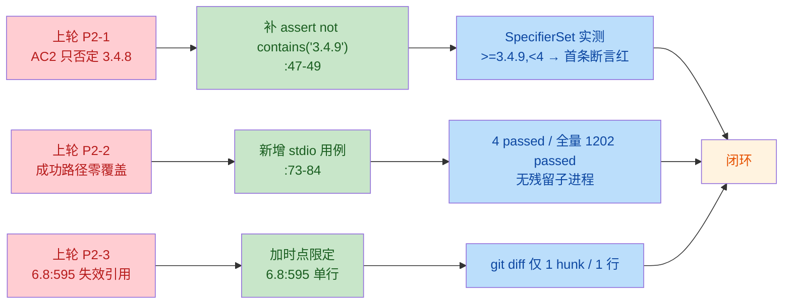

# v0.17.54 代码评审修复后复审（rereview）

- **日期**：2026-11-11
- **被复审报告**：`docs/reviews/2026-11-11-v0.17.54-code-review.md`（P0 0 / P1 1 / P2 3，结论「有条件通过」）
- **被复审 spec**：`docs/specs/security-hardening-fastmcp-3.4.10.md`
- **基线 HEAD**：`52fc3b8`（v0.17.53）；升级目标 fastmcp `3.4.10`（本机实测已装 3.4.10）
- **产出方式**：只读复审。唯一写入 = 本报告；未修改任何被评审文件，未执行 `git add` / `commit` / `push`
- **命名说明**：CODING-STANDARDS 5.2 的复审命名为 `YYYY-MM-DD-v0.17.xx-<修复后短hash>-rereview.md`。本批尚未提交、无修复后短 hash，故沿同日 spec 整改复审 `2026-11-11-v0.17.54-rereview.md` 的「无 hash」先例，并加 `code-review` 前缀区分两轮复审对象。

## 0. 复审范围、判据与证据

**判据**：

- `.trae/skills/spec-first/SKILL.md:116`「修复后复审：条件」——本轮由「代码评审确认的 P2 已整改（改测试 + 改文档）」触发，属必做。
- SKILL.md:132「声称做过评审但 `docs/reviews/` 无报告或 spec 未引用，视为未做」——本报告须存在且被 spec 引用，否则复审关卡按未做处理（见 §6 动作 2）。
- `docs/CODING-STANDARDS.md:231`「修复后复审……只查上轮问题关闭与本轮新改动，最多 2 轮，每轮须『上轮问题全部关闭且本轮新增 P0/P1 不高于上轮新增』」——本轮为第 1 轮复审，上轮新增 P1 = 1，本轮新增 P0/P1 须 ≤ 1。
- `docs/CODING-STANDARDS.md:233`「报告不存在等于关卡未做」；`:206` 禁用恒真断言与无效断言。

**工作区实测（与本轮整改相关）**：

```text
 M README.md
 M docs/ENGINEERING-METRICS.md
 M docs/PLAN.md
 M docs/specs/6.8-run-wallclock-duration.md      ← 本轮新增的改动（上一轮评审时为干净）
 M requirements.txt
?? docs/reviews/2026-11-11-fastmcp-spec-review.md
?? docs/reviews/2026-11-11-v0.17.54-code-review.md
?? docs/reviews/2026-11-11-v0.17.54-rereview.md
?? docs/specs/security-hardening-fastmcp-3.4.10.md
?? tests/test_dependency_versions.py
```

`git diff --stat`：`README.md +4/-1`、`ENGINEERING-METRICS.md 8`、`PLAN.md +1`、`6.8 spec 2`、`requirements.txt +4/-1`。除 6.8 spec 外，其余 diff 与上一轮评审时的内容一致（未出现新的实现改动）。

**整改闭环链路**：



## 1. P2-1：AC2 下界退一个补丁号能否被卡住 —— 已闭环

整改后的断言（`tests/test_dependency_versions.py:47-49`、`:54-57`）：

```python
assert not specifier.contains("3.4.9"), "requirements.txt 下限低于安全下限：3.4.9 仍在允许集内（修复版从 3.4.10 起）"
assert not specifier.contains("4.0.0"), ...
assert not specifier.contains("4.1.2"), ...
assert specifier.contains(FASTMCP_SECURITY_FLOOR), ...
assert specifier.contains("3.4.11"), ...
```

**packaging 实测矩阵**（探针顺序：`3.4.9` / `4.0.0` / `4.1.2` / `3.4.10` / `3.4.11`）：

| 约束写法 | contains 结果 | AC2 判定 |
|---|---|---|
| `>=3.4.10,<4`（现行 `requirements.txt:13`） | `F, F, F, T, T` | 全绿 |
| `>=3.4.9,<4`（下界退一个补丁号） | **`T`**, F, F, T, T | **首条断言红** |
| `>=3.4.8,<4` | **`T`**, F, F, T, T | 首条断言红 |
| `>=3.4.10`（只写下限） | F, **`T`**, **`T`**, T, T | 第 2/3 条断言红 |
| `>=3.4.10,<5`（上界放宽） | F, **`T`**, **`T`**, T, T | 第 2/3 条断言红 |
| `>=3.4.10,<=4` | F, **`T`**, F, T, T | 第 2 条断言红 |

结论：**下界退一个补丁号必红，上界缺失/放宽必红，正常区间不误伤**，与 spec §5（`:300-302`）与 §7.4（`:413-415`）的描述一致。判为**已闭环**。

补充核对（不构成问题）：

- `>3.4.9` / `~=3.4.10` 这类等价安全写法能通过断言，这是正确行为（前者不含受影响版本，后者仍允许 3.4.x 补丁），断言设计没有把「正确写法」误判为红。
- 断言仍是采样式（不是区间等价判定），但已采样到受影响区上界 `3.4.9` 与首修复版 `3.4.10` 这组差一补丁号的相邻点，守护强度满足 P2-1 的要求，无需再做集合运算断言。

## 2. P2-2：新增 stdio 用例的真实性、有效性、泄漏与稳定性 —— 已闭环

**（a）确实走真实 stdio 子进程**：`tests/test_dependency_versions.py:73-84` 调用 `agent.load_mcp_tools()`；该函数（`server/agent.py:68-83`）用 `MultiServerMCPClient` 以 `command=sys.executable`、`args=[config.MCP_SERVER_SCRIPT]`、`transport="stdio"` 拉起子进程，再 `await client.get_tools()`。适配层内部 `async with create_session(...)` 在退出上下文时关闭 stdio 会话与子进程。**不是 in-process 直调**（那是 `:60-70` 的另一条用例）。

**（b）断言有效性（无「被测代码失败仍通过」的通道）**：

- `load_mcp_tools` 的失败路径是 `except Exception → return []`（`server/agent.py:81-83`），而用例首条断言是 `assert tools`，空列表必红；第二条断言再验 `get_city_weather` 在工具名集合中，避免「拉起了别的服务端也算过」。
- 用例没有 `try/except` 包裹、没有 `skip` 分支、没有门控变量，因此不存在「条件不满足就跳过 → 报 passed」的通道。
- 关键点：conftest 的 `MCP_ENABLED=false`（`tests/conftest.py:27`）**不会**让这条用例空转——开关只作用于 `build_agent`（`server/agent.py:180`），`load_mcp_tools` 本身不读该开关。由此既复用了测试隔离，又真正走到了成功路径。
- 断言只校验工具名、不调用工具，避免把网络（Open-Meteo/itboy 降级链）引入回归，取舍正确。

**（c）实测**：

```text
$ .venv\Scripts\python.exe -m pytest tests/test_dependency_versions.py -q
4 passed in 9.61s

$ .venv\Scripts\python.exe -m pytest -q
1202 passed, 20 skipped, 2 warnings in 153.20s (0:02:33)
```

全量数字与 spec §7.1（`:341-359`）的 1202 / 20 / 0 一致；与实现方两次全量（142.38s / 144.89s）合计，该用例已在 3 次独立全量回归中稳定通过。

**（d）泄漏**：上述两次运行结束后 `Get-CimInstance Win32_Process -Filter "Name='python.exe'"` 均为空，无残留 MCP 子进程。注意 Windows 的 venv 启动器会呈现「`.venv\Scripts\python.exe` + 基座 `python.exe`」一对同名进程，属正常现象，不要误判为泄漏。

**（e）残留风险（新发现，P2 建议项，不阻断）**：用例没有超时上限，`pytest.ini` 也只有 `testpaths = tests`（无 `timeout` 配置）。若子进程在启动阶段卡住（杀软拦截、DLL/端口异常），表现会是**整个套件阻塞**而不是快速失败。建议：

```python
async def _load():
    return await asyncio.wait_for(agent.load_mcp_tools(), timeout=30)

tools = asyncio.run(_load())
```

判为**已闭环**（原 P2-2 的「成功路径零自动化覆盖」缺口已消除）；上述超时属加固建议，不计为本轮遗留缺陷。

## 3. P2-3：6.8 spec 时点限定是否只改该处、无连带副作用 —— 已闭环（附一处文档自相矛盾）

`git diff docs/specs/6.8-run-wallclock-duration.md` 实测：**1 个 hunk、1 行**，且只改 `:595`：

```diff
-  fastmcp 落后于 `requirements.txt` 可解析到的版本（声明为 `>=2.3`）；按用户
+  fastmcp 落后于 `requirements.txt` 可解析到的版本（v0.17.54 之前声明为 `>=2.3`）；按用户
```

- 语义正确：该段是 2026-11-10 的历史扫描记录，加「v0.17.54 之前」后不再与现行 `requirements.txt:13`（`>=3.4.10,<4`）矛盾。
- 无连带副作用：该文件只有这一处 diff；本批复跑未见其他 6.8 内容变动。
- **但**：本 spec 自己的边界声明没有同步——`docs/specs/security-hardening-fastmcp-3.4.10.md:280-281` 仍写「不动 `docs/specs/6.8-*`」，而 §7.4（`:424`）与 §9.1（`:549`）已记录这处改动（用户指示覆盖评审建议）。这是**同一份 spec 内前后矛盾**（P2，纯文档，见 §5-N2），不是代码副作用，也不影响 P2-3 的闭环判定。

## 4. P1：报告表述是否会被误读为代码缺陷 —— 表述合格，计数口径需更正

**（a）不会被误读为代码缺陷**：被复审报告在三处明写性质——

- `:87`「提交清单漏列两份被 spec 引用的评审报告（**非代码缺陷**，提交前补齐即可）」
- `:96`「P1（**提交阻断，非代码缺陷**）」；`:98`「**代码本身没有问题**，但只提交 6 个路径会让门禁证据在仓库里消失」
- `:167`「唯一 P1 是提交清单漏列……补齐后即可提交」

结论：表述清晰地把问题限定在「提交完整性/证据链」，不会让人以为依赖约束或代码有缺陷。

**（b）计数口径存在偏差（P2，不改变 P1 性质）**：报告 P1 行与 spec `:16`、`:429`、`:542` 都写「两份」，实际 spec 引用了**三份**（`spec-review` `:7`、`rereview` `:10`、`code-review` `:14`），报告 `:160` 的提交动作也是「8 + 1 = 9 个路径」（含报告自身）。加上本轮复审报告后，随本批提交的评审/复审产物共 **4 份**、总路径 **10 个**。

**（c）P1 的关闭主体与判据**：用户已明确「由协调方在提交时补齐」，因此该 P1 无法在只读工作区里关闭；本轮仅核对「表述不误导」与「补齐口径完整」，两项均已给出结论。**不重复计为本轮新问题。**

## 5. 本轮整改是否引入新 P0/P1 —— 无；新增 P2 四条

| 编号 | 级别 | 位置 | 问题 | 影响 | 建议 |
|---|---|---|---|---|---|
| N1 | P2 | `README.md:9` | 仍写「新增 **3** 个依赖约束用例，全量 **1201** 个用例通过」，与整改后 4 条用例、全量 1202 实测不符（整改前该行是自洽的，是补用例后未同步） | README 与 spec §7.1、实测结果三处口径不一；读者会低估本批覆盖面 | 改为「4 个依赖约束用例，全量 1202 个用例通过（20 skipped 语义不变）」 |
| N2 | P2 | `docs/specs/security-hardening-fastmcp-3.4.10.md:280-281` | 「不动 `docs/specs/6.8-*`」与 §7.4 `:424` / §9.1 `:549` 的实际改动记录冲突 | 同一 spec 内边界声明与实际交付矛盾，复审/审计读者会误判为越界 | 改为「除 P2-3 指定的 6.8 `:595` 一处时点限定外，不改 `docs/specs/6.8-*`」 |
| N3 | P2 | `tests/test_dependency_versions.py:82` | 新 stdio 用例无超时上限；`pytest.ini` 无全局 timeout | 子进程启动异常时表现为套件阻塞，而非快速失败 | 用 `asyncio.wait_for(..., timeout=30)` 包裹（见 §2e） |
| N4 | P2 | `docs/reviews/2026-11-11-v0.17.54-code-review.md:87`；spec `:16`、`:429`、`:542` | 「两份评审报告」与实际的 4 份评审/复审产物、10 个提交路径不一致 | 协调方按「两份」补齐会漏带报告，重演上一轮 P1 | 统一改为「三份评审报告 + 本复审报告」，提交清单按 §6 的 10 个路径执行 |

**为什么都不是 P1**：四条全部是文档/断言强度/稳定性问题，不改运行时行为，也不使现行实现变错；按 CODING-STANDARDS 5.2 的复审判据，本轮新增 P0/P1 = 0 ≤ 上轮新增 1，满足通过条件。**若按「两份」提交导致评审产物缺失，则退化为上一轮 P1 未闭环**——这是提交动作的约束，不是本轮整改引入的代码问题。

## 6. 结论

**通过。**

| 级别 | 本轮新增 | 说明 |
|---|---|---|
| P0 | 0 | 无 |
| P1 | 0 | 上轮 P1 属提交完整性、非代码缺陷，按用户安排由协调方在提交时补齐 |
| P2 | 4 | 见 §5（全部为文档口径/超时加固） |

**逐条判定**：

| 上轮项 | 判定 | 证据 |
|---|---|---|
| P2-1 | **已闭环** | `tests/test_dependency_versions.py:47-49`；`>=3.4.9,<4` 实测首条断言必红 |
| P2-2 | **已闭环** | `tests/test_dependency_versions.py:73-84`；4 passed / 全量 1202 passed / 无残留进程 |
| P2-3 | **已闭环** | `git diff` 仅 `6.8:595` 一行；spec 边界句未同步另记 N2 |
| P1 | 表述合格、口径待更正 | 报告 `:87/:96/:98/:167` 明写「非代码缺陷」；计数见 N4 |

**提交前动作（供协调方，按顺序执行）**：

1. 提交清单：上一轮的 9 个路径 + 本报告 = **10 个路径**（`requirements.txt`、`tests/test_dependency_versions.py`、`docs/specs/security-hardening-fastmcp-3.4.10.md`、`README.md`、`docs/PLAN.md`、`docs/ENGINEERING-METRICS.md`、`docs/specs/6.8-run-wallclock-duration.md`、四份评审/复审报告），仍按路径 + 片段核对，不整文件 `git add`。
2. spec §9 增加本报告引用（`docs/reviews/2026-11-11-v0.17.54-code-review-rereview.md`，结论「通过」），否则按 SKILL.md:132 / CODING-STANDARDS:233 的机械核对会被判为复审未做。
3. 修 N1（README:9 计数）与 N2（spec:280-281 边界句）+ N4（「两份」口径），三处均为一行级文档改动。
4. N3 超时包裹可作为后续加固，不阻断提交。

## 7. 核对后不成立

- **「新用例会被 `MCP_ENABLED=false` 跳过，等于没测」：不成立。** 开关只在 `server/agent.py:180` 的 `build_agent` 分支生效；`load_mcp_tools`（`:68-83`）不读该配置，用例实测 4 passed，且空列表会被 `assert tools` 拦下。
- **「`load_mcp_tools` 吞异常会让用例假绿」：不成立。** 吞异常的结果是返回 `[]`，正是首条断言要拦的状态；只有真正拿到 `get_city_weather` 才会通过。
- **「新用例引入网络依赖或污染工作区」：不成立。** 用例只列举工具、不调用；子进程的 `STATE_DB` / 目录类环境变量已由 conftest 指向临时目录。
- **「全量回归因新用例变慢到不可接受」：不成立。** 定向 9.61s（含解释器启动）、全量 153.20s（实现方 142.38s / 144.89s），增量在数秒级。
- **「6.8:595 的改动造成 6.8 其他段落失效」：不成立。** diff 只有 1 行，且限定词使该历史陈述与现行约束不再矛盾。
- **「本轮整改夹带了实现代码改动」：不成立。** `git diff --stat` 中 `requirements.txt` / README / PLAN / METRICS 与上一轮评审时一致；本轮唯一新增 diff 是 6.8 spec 的 1 行。
