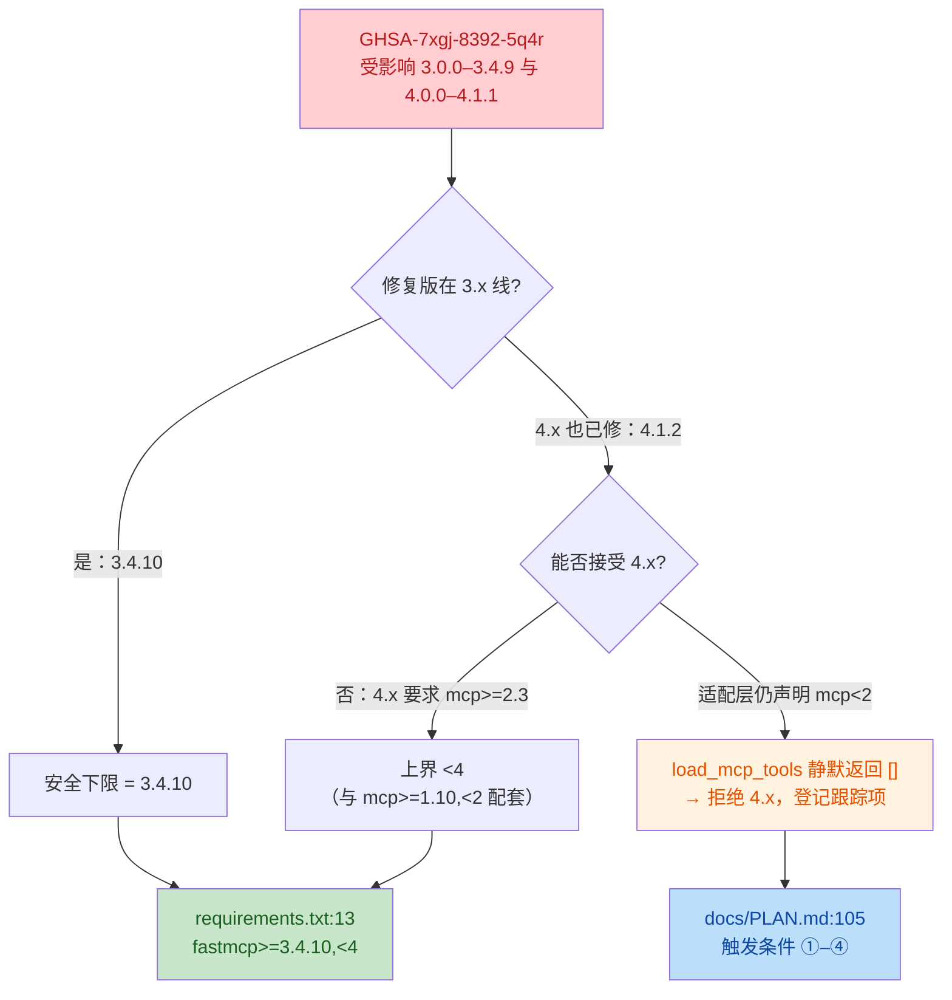
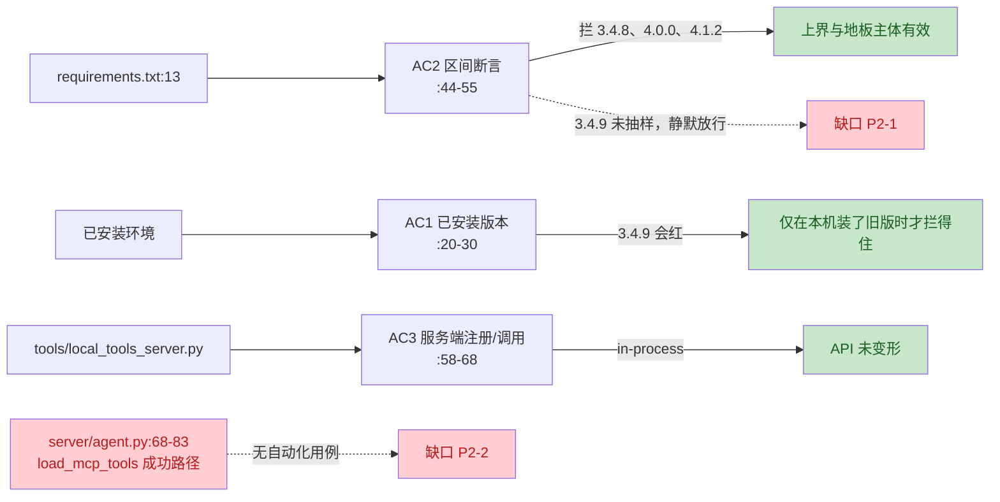

# v0.17.54 fastmcp 安全下限升级 — 提交前代码评审

**评审日期**：2026-11-11
**评审性质**：提交前硬门禁评审（spec-first 最后一道关卡），全量核对本批未提交改动
**基线**：HEAD `52fc3b8`（v0.17.53）；改动全部未提交、未 push
**产出方式**：只读评审。唯一写入 = 本报告；未修改任何被评审文件，未执行 `git add` / `commit` / `push`

## 0. 范围与证据

`git status --porcelain` 实测本批共 **8 个路径**（用户列出 6 个，另有 2 个被 spec 引用但未列入提交清单，见 P1-1）：

| 路径 | 状态 | 本批内容 |
|---|---|---|
| `requirements.txt` | M | `fastmcp>=2.3` → `fastmcp>=3.4.10,<4`（+2 行注释） |
| `tests/test_dependency_versions.py` | ?? | 新增 3 条用例（AC1/AC2/AC3） |
| `docs/specs/security-hardening-fastmcp-3.4.10.md` | ?? | 本轮 spec |
| `README.md` | M | `:3` 版本号、`:9` 版本记录 |
| `docs/PLAN.md` | M | `:105` 追加跟踪项第 6 行 |
| `docs/ENGINEERING-METRICS.md` | M | `:124` S5 基线追加、`:128` 失败动作 |
| `docs/reviews/2026-11-11-fastmcp-spec-review.md` | ?? | spec 独立评审（spec `:7` 引用） |
| `docs/reviews/2026-11-11-v0.17.54-rereview.md` | ?? | 整改复审（spec `:10` 引用） |

### 执行过的验证（本机 `.venv`）

```text
fastmcp 3.4.10 / fastmcp-slim 3.4.10 / mcp 1.30.0 / langchain-mcp-adapters 0.3.2
python -m pip check                     → No broken requirements found.
pytest tests/test_dependency_versions.py -q → 3 passed
pytest -q --collect-only                → 1221 collected（= 1201 passed + 20 skipped，与 README:9 / spec §7.1 自洽）
```

### 提交范围洁净度

三个被并行改动过的文件（`README.md` / `docs/PLAN.md` / `docs/ENGINEERING-METRICS.md`）逐一核对 diff：**均只有本批片段**，没有把其他会话的改动带进来——`PLAN.md` 仅追加 `:105` 一行；`README.md` 仅 `:3` 与 `:9`；`ENGINEERING-METRICS.md` 仅 `:124` 的 S5 追加与 `:128` 的失败动作。**范围干净**（唯一缺口是漏列被引用的评审/复审报告，见 P1-1）。

## 1. 推断意图

先把 fastmcp 抬到 3.x 线首个修复版 3.4.10 以消除 GHSA-7xgj-8392-5q4r，再用 `<4` 把依赖钉在 mcp 1.x 兼容线内：4.x 要求 `mcp>=2.3`，而 LangChain 适配层 0.3.2 声明 `mcp<2` 且 import 了 mcp 2.x 已移除的 `mcp.server.fastmcp`，硬升会让 `load_mcp_tools` 静默降级为空列表。配套用 3 条用例把「安全下限 + 上界 + MCP 注册行为」固定下来，并把 4.x 的再评估条件写进 PLAN 跟踪项。

## 2. 变更概览

**依赖解析决策链（为什么是 `>=3.4.10,<4`）：**



**三条用例实际守住了什么（红色 = 本次评审发现的缺口）：**



## 3. 结论

**有条件通过。**

| 级别 | 条数 | 说明 |
|---|---|---|
| P0 | 0 | 无 |
| P1 | 1 | 提交清单漏列被 spec 引用的评审/复审报告（非代码缺陷，提交前补齐即可）。**2026-11-11 复审后更正计数**：本批共 4 份评审/复审产物、11 个提交路径（7 个实现/文档 + 4 份报告），以 spec §7.4 明细为准 |
| P2 | 3 | AC2 地板抽样缺口、`load_mcp_tools` 成功路径零自动化覆盖、6.8 spec 失效引用 |

依赖约束本身（下限、上界、与 `mcp` / `litellm[proxy]` 的兼容性）**核对无误**；测试的上界断言确实能卡住「只写下限」的写法；`tools/local_tools_server.py` 与 `load_mcp_tools` 的降级语义未被改动。P1 补齐后即可提交。

## 4. P1 明细

| ID | 级别 | 位置 | 问题 | 影响 | 建议 |
|---|---|---|---|---|---|
| P1-1 | P1（提交阻断，非代码缺陷） | `docs/specs/security-hardening-fastmcp-3.4.10.md:7`、`:10`、`:14`、`:18` | spec 正文多处引用评审/复审报告，但它们均为未跟踪文件（`git status` 显示 `??`），且不在用户列出的提交清单里 | 若按路径精确提交 6 个主路径，仓库内 spec 会指向不存在的文件；按本项目「报告不存在等于关卡未做」的口径，等于 spec-first 证据链断裂 | 按 spec §7.4 的清单补齐（**11 个路径**：7 个实现/文档 + 4 份评审/复审产物）；它们都是本批全新文件，无并行改动风险 |

**为什么定 P1 而不是 P2**：这不是风格问题，而是提交完整性——本批的性质是「安全加固 + 评审留证」，spec `:14-16` 明确把评审作为提交前硬门禁。代码本身没有问题，但只提交 6 个路径会让门禁证据在仓库里消失，属于必须在本批解决的事项。

## 5. P2 明细

| ID | 级别 | 位置 | 问题 | 影响 | 建议 |
|---|---|---|---|---|---|
| P2-1 | P2 | `tests/test_dependency_versions.py:47`（配合 `:52-55`）；约束位置 `requirements.txt:13` | AC2 的地板只抽样 `3.4.8`，未抽样 `3.4.9`（受影响区上界，即 `>=3.0.0,<3.4.10` 的最后一个漏洞版本） | 把约束回退成 `fastmcp>=3.4.9,<4` 时，AC2 五条断言**全部仍然通过**（已实测），安全下限退一个补丁号不会被发现 | 增加 `assert not specifier.contains("3.4.9")`，或改为「`specifier <= 3.4.9` 的交集为空」的断言 |
| P2-2 | P2 | `tests/test_dependency_versions.py:58-68`；`tests/conftest.py:27`；`tests/test_agent_llm.py:59-63`；`server/agent.py:68-83` | 三条用例只覆盖 in-process 服务端 API；真正会「静默降级」的 `load_mcp_tools` 成功路径没有任何自动化用例（conftest 固定 `MCP_ENABLED=false`，既有用例只测失败返回空列表） | 本轮拒绝 4.x 的核心理由是「适配层 import 失败 → 空列表」，但这条路径的回归保护仍只靠仓库外手工脚本（`%TEMP%` 下，重启即不可复核）；若未来升到 3.5/适配层变更导致同种静默降级，全量回归仍是绿的 | 加一条会真实启动 stdio 子进程、断言 `load_mcp_tools()` 非空且含 `get_city_weather` 的用例（可用 `RUN_MCP_TESTS` 门控，与现有 `RUN_LLM_TESTS` 同风格） |
| P2-3 | P2 | `docs/specs/6.8-run-wallclock-duration.md:595` | 6.8 spec 仍写「fastmcp 落后于 requirements.txt 可解析到的版本（声明为 `>=2.3`）」，本轮已把 requirements 改为 `>=3.4.10,<4`，该括号成了失效引用 | 后续读者会以为 requirements 仍声明 `>=2.3`，与 `requirements.txt:13` 直接矛盾 | 本轮 spec `:280` 已禁止改动 `docs/specs/6.8-*`，故不建议本批动它；改为在本 spec §7.4 或提交说明里记一句「6.8:595 的 `>=2.3` 已于本批失效」，并在 6.8 的下次文档维护中把该括号改成「截至 2026-11-10 当时为 `>=2.3`」 |

### 5.1 P2-1：地板抽样只差一个补丁号

`tests/test_dependency_versions.py:47` 只否定 `3.4.8`。实测把 `requirements.txt:13` 改成 `fastmcp>=3.4.9,<4` 后：

```text
not contains("3.4.8")   → True   （>=3.4.9 确实不含 3.4.8）
not contains("4.0.0")   → True
not contains("4.1.2")   → True
contains("3.4.10")      → True
contains("3.4.11")      → True
contains("3.4.9")       → True   ← 仍在 GHSA 受影响区间，却无人拦截
```

**为什么定 P2 而不是 P1**：当前 `requirements.txt:13` 是正确的 `>=3.4.10,<4`，不存在现行漏洞；要触发这个缺口，必须有人主动把约束回退到 3.4.9 且不被 review 发现。它是「守护强度不足」，不是「当前错误」。但正因为这是安全下限唯一的自动化守卫，建议提交前一并补上（一行断言）。

### 5.2 P2-2：被防范的风险本身没有回归用例

`tests/conftest.py:27` 把 `MCP_ENABLED` 固定为 `false`，`tests/test_agent_llm.py:59-63` 只验证「脚本缺失 → 返回空列表」。`server/agent.py:68-83` 的 `get_tools()` 在成功时返回什么、是否仍能拿到 `get_city_weather`，测试套件里没有任何断言。spec §2.1 证据第 8 条确实有手工 stdio 实测，但它落在仓库外临时目录，重启即不可复核。

**为什么定 P2 而不是 P1**：升级本身是补丁级变更（3.4.8 → 3.4.10），服务端 API 已有 AC3 覆盖，手工证据也已完成；缺的是「未来不再退化」的守卫，而不是「本次改坏了」。建议以门控用例补齐，不阻塞本批。

### 5.3 P2-3：跨文档引用漂移

`docs/specs/6.8-run-wallclock-duration.md:595` 的括号是现状语气（「requirements.txt 可解析到的版本（声明为 `>=2.3`）」），但本轮之后已不成立。由于本轮 spec `:280` 明确把 `docs/specs/6.8-*` 列为禁改区，这条只能在文档维护窗口处理，故只要求留一句失效说明。

**为什么定 P2 而不是 P1**：纯文档、不影响运行时与测试；且 6.8 spec 该段属于 2026-11-10 的历史扫描记录，读者结合上下文不易误操作。

## 6. 核对后不成立

- **「`<4` 上界卡不住只写下限的写法」：不成立。** `SpecifierSet(">=3.4.10").contains("4.0.0")` 为 `True`，会让 `tests/test_dependency_versions.py:48-50` 变红；`contains("4.1.2")` 同理。上界断言有效。
- **「`<4` 会放进 4.0.0rc1 这类预发布」：不成立。** 实测 `SpecifierSet("<4").contains("4.0.0rc1", prereleases=True)`、`4.0.0.dev1`、`4.0.0a1` 均为 `False`（PEP 440 排他上界排除目标版本的预发布）。
- **「把安全下限写成了精确锁定」：不成立。** `>=3.4.10,<4` 允许 3.4.11；`:55` 的 `contains("3.4.11")` 会让 `==3.4.10` / `<3.4.11` 变红。
- **「`_fastmcp_requirement` 漏掉换行或 extras 边界」：不成立。** `:35` 先剥行内注释再解析，`:39` 用 `Requirement.name.lower()` 精确匹配；实测 `fastmcp[client]>=3.4.10,<4` 的 `name` 为 `fastmcp`，`FASTMCP` 大小写可命中，仅有 `fastmcp-slim` 行时会抛明确 `AssertionError` 而不是误配（N4 已闭环）。当前 `requirements.txt` 无 `-r` / `--index-url` 这类非 PEP 508 行，不存在解析异常路径。
- **「与 `mcp` / `litellm[proxy]` 的兼容性写错了」：不成立。** `fastmcp 3.4.10` 的元数据精确锁定 `fastmcp-slim[client,server]==3.4.10`，后者要求 `mcp>=1.24.0,<2`，与 `requirements.txt:19` 的 `mcp>=1.10,<2` 交集非空（实际安装 1.30.0）；`pip check` 无冲突。`docs/DEPLOYMENT.md:139-141` 关于 `litellm[proxy]` 会拉 `mcp` 2.x 的旧注记**仍然准确**（4.x 才要求 `mcp>=2.3`，3.x 一直要求 `<2`），不需要改。
- **「`tools/local_tools_server.py` 行为变了」：不成立。** 该文件不在本批 diff 内；AC3 在本机 3.4.10 上通过，注册集合仍为 `{get_city_weather}`、返回文本一致。
- **「`load_mcp_tools` 的降级语义变了」：不成立。** `server/agent.py:68-83` 未改动，失败仍返回空列表；缺的是成功路径的自动化覆盖（已单列 P2-2），不是语义变化。
- **「README/PLAN/METRICS 混入了并行改动」：不成立。** 三份文件 diff 均只含本批片段，见 §0。
- **「两条评审报告的行号与提交版不一致」：不成立为缺陷。** 复审报告引用的 `tests/test_dependency_versions.py:41-52` / `:55` 比当前文件少 3 行，是复审之后按 N4 整改（`_fastmcp_requirement` 改为按 `Requirement.name` 精确匹配）造成的位移；整改后定向用例复跑 `3 passed`，行为结论不受影响。
- **「`docs/ENGINEERING-METRICS.md:124` 的『本轮不动』与已升级矛盾」：不成立。** 该句属于 2026-11-03 的历史基线，紧接的「2026-11-11 升级 fastmcp 3.4.10」是追加更新，时间顺序自洽（可读性一般，不计问题）。

## 7. 测试与验收证据

| AC | 用例 | 本次实测 | 判定 |
|---|---|---|---|
| AC1 | `test_ac1_fastmcp_within_security_window`（`:20-30`） | 本机 3.4.10 在窗口内，通过 | 有效（仅能拦住「环境里真的装了旧版」） |
| AC2 | `test_ac2_requirements_fastmcp_window`（`:44-55`） | 通过；上界四条断言有效，地板缺 3.4.9 抽样（P2-1） | 部分有效 |
| AC3 | `test_ac3_mcp_server_registers_and_calls_weather_tool`（`:58-68`） | 通过；仅覆盖服务端 in-process（P2-2） | 有效但覆盖面偏窄 |
| AC4 | pip-audit 手工留证（spec §7.2） | 未复跑（需外网）；按 spec 记录采信 | 采信 |
| AC5 | 全量回归 | `collect 1221 = 1201 passed + 20 skipped`，与 README:9 自洽 | 采信（复审已实跑 136.95s） |

## 8. 提交前动作

1. **（P1）** 按 spec §7.4 的清单提交 **11 个路径**（7 个实现/文档：`requirements.txt`、`tests/test_dependency_versions.py`、本 spec、`README.md`、`docs/PLAN.md`、`docs/ENGINEERING-METRICS.md`、`docs/specs/6.8-run-wallclock-duration.md`；4 份评审/复审报告：`2026-11-11-fastmcp-spec-review.md`、`2026-11-11-v0.17.54-rereview.md`、`2026-11-11-v0.17.54-code-review.md`、`2026-11-11-v0.17.54-code-review-rereview.md`）；按 spec `:288-290` 的提示按路径 + 片段核对，不要整文件 `git add`。
2. **（建议）** 补 `assert not specifier.contains("3.4.9")`（P2-1），复跑 `pytest tests/test_dependency_versions.py -q`。
3. **（可延后）** 加门控的 `load_mcp_tools` 成功路径用例（P2-2）；在文档维护中修正 `docs/specs/6.8-run-wallclock-duration.md:595`（P2-3）。
4. 把本报告的结论回写 spec §7.4（spec `:14-16` 要求；回写属提交动作，不在本次只读评审范围内）。

## 9. 结论

**有条件通过。** 依赖约束、上界防护、MCP 服务端回归与提交范围洁净度均核对通过；唯一 P1 是提交清单漏列被 spec 引用的评审/复审报告（2026-11-11 复审后计数更正为 4 份产物、11 个提交路径），补齐后即可提交。三条 P2 不阻断：P2-1 建议随本批补一行断言，P2-2 建议后续加门控用例，P2-3 属跨文档漂移、留待文档维护。
